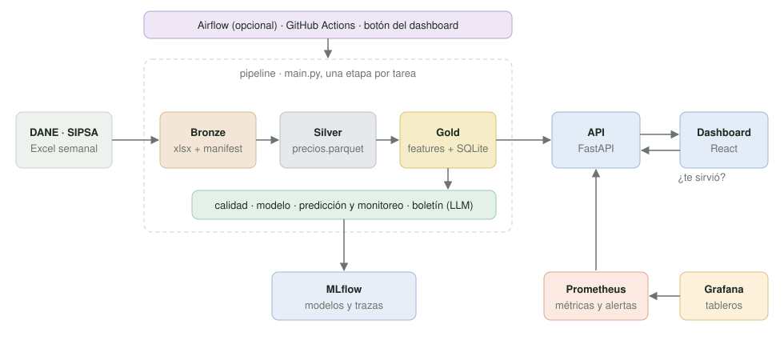

# AgroPrecio

Alertas semanales de compra para restaurantes pequeños de Cali, basadas en los precios mayoristas de Cavasa que publica el DANE (SIPSA).

Cada semana AgroPrecio descarga el boletín del SIPSA, predice si el precio de 20 insumos frescos va a **subir, bajar o seguir estable** la semana siguiente y le dice al dueño del restaurante qué le conviene comprar ya y qué puede esperar. Claude redacta el mensaje en lenguaje sencillo.



## El problema

Un restaurante pequeño gasta buena parte de su costo en frutas, verduras y tubérculos, y esos precios cambian mucho de una semana a otra. El DANE publica cada viernes los precios de todas las centrales mayoristas del país, pero en un Excel de más de 4.000 filas que casi nadie consulta. La decisión de compra se toma a ojo.

Más detalle en [docs/01_problema_y_kpis.md](docs/01_problema_y_kpis.md).

## Cómo correrlo

### Con Docker (recomendado)

```bash
cp .env.example .env          # opcional: poner ANTHROPIC_API_KEY
docker compose up --build
```

- `pipeline`: descarga los boletines, limpia, entrena si hace falta, predice y genera el boletín. Termina y se apaga.
- `api`: FastAPI en http://localhost:8000 (documentación en `/docs`).
- `web`: dashboard en React en http://localhost:8080.

La primera ejecución descarga unos 180 boletines (~50 MB) y tarda unos minutos. Las siguientes solo bajan los boletines nuevos.

### Sin Docker

```bash
python -m venv .venv && source .venv/bin/activate
pip install -r requirements.txt
python main.py                 # pipeline completo
uvicorn api.main:app --reload  # API
cd frontend && npm install && npm run dev   # dashboard en http://localhost:5173
```

Opciones del pipeline:

| Comando | Qué hace |
|---|---|
| `python main.py` | Descarga lo nuevo y corre todo |
| `python main.py --sin-descarga` | Usa solo lo que ya está en `data/bronze` |
| `python main.py --reentrenar` | Fuerza un modelo nuevo |

Tests: `pytest -q`

Para el notebook de exploración: `pip install -r requirements-dev.txt`.

## Arquitectura de datos (medallón)

| Capa | Dónde | Contenido |
|---|---|---|
| Bronze | `data/bronze/*.xlsx` + `manifest.csv` | Boletines tal como los publica el DANE, con su URL y fecha de descarga |
| Silver | `data/silver/precios.parquet` | Una fila por semana, producto y mercado, para todo el país (~786 mil filas) |
| Gold | `data/gold/features.parquet` y `agroprecio.db` | Serie semanal de Cavasa para 20 productos, variables del modelo, predicciones, alertas, monitoreo y boletines |

Cada ejecución corre 11 reglas de calidad sobre silver y gold y las guarda en la tabla `calidad_datos`. Si falla una regla crítica, el pipeline se detiene antes de entrenar o publicar.

## Modelo

- **Qué predice:** la clase del cambio de precio de la próxima semana (`sube` > +3 %, `baja` < -3 %, `estable` en medio).
- **Variables:** cambios de 1, 2 y 4 semanas, distancia a la media móvil, diferencia contra la mediana nacional, cambio nacional y mes.
- **Algoritmo:** Random Forest de scikit-learn, sin tuning. La idea del MVP es gestionar bien el ciclo de vida del modelo, no exprimir la métrica.
- **Validación:** corte temporal, con las últimas 20 semanas como prueba. Se compara siempre contra dos baselines.

| | Accuracy | F1 macro | Ahorro simulado |
|---|---|---|---|
| Random Forest | 0,45 | 0,45 | +0,4 % |
| Baseline: repetir lo de la semana pasada | 0,40 | 0,40 | -0,3 % |
| Baseline: siempre estable | 0,27 | 0,14 | 0 % |

Un modelo solo pasa a producción si le gana al baseline. Las versiones quedan en `models/registry.json` con sus datos, parámetros y métricas. Ver [docs/model_card.md](docs/model_card.md).

## Operación (MLOps, LLMOps y DataOps)

- **CI** (`.github/workflows/ci.yml`): tests y construcción de las imágenes Docker en cada push.
- **Pipeline semanal** (`.github/workflows/pipeline_semanal.yml`): corre cada sábado, baja el boletín nuevo y publica la base y el registro del modelo como artefactos.
- **Monitoreo:** se cruza cada predicción con lo que realmente pasó, se calcula el acierto de las últimas 8 semanas y se marca drift cuando un cambio de precio es atípico (z > 3). Si el acierto cae por debajo de 0,40 y hay datos nuevos, el siguiente run reentrena.
- **LLM:** cada llamada a Claude queda en `logs/llm.jsonl` con prompt, respuesta, tokens y latencia. Si el texto trae precios que no están en los datos, se descarta y se usa la plantilla. Sin API key, el producto funciona igual con la plantilla.

Detalle en [docs/05_operacion.md](docs/05_operacion.md).

## Estructura

```
├── main.py                  # orquesta el pipeline
├── config/config.yaml       # mercado, productos, umbrales, rutas
├── src/
│   ├── extract/             # descarga y lectura de los Excel del SIPSA
│   ├── transform/           # limpieza (silver) y variables (gold)
│   ├── load/                # SQLite
│   ├── model/               # entrenamiento, predicción, monitoreo
│   ├── llm/                 # boletín con Claude
│   └── quality.py           # reglas de calidad de datos
├── api/                     # FastAPI
├── frontend/                # React + Vite
├── tests/
├── notebooks/               # exploración
├── docs/                    # problema, lienzos, metodología, operación
├── data/{bronze,silver,gold}
├── models/  logs/
├── Dockerfile  docker-compose.yml
```

## Documentación

1. [Problema, usuarios y KPIs](docs/01_problema_y_kpis.md)
2. [Business Model Canvas](docs/02_canvas.md)
3. [Data Innovation Board](docs/03_data_innovation_board.md)
4. [Metodología: CRISP-DM y Scrum ML](docs/04_metodologia.md)
5. [Operación: DataOps, MLOps y LLMOps](docs/05_operacion.md)
6. [Model card](docs/model_card.md)
7. [Diccionario de datos](docs/diccionario_datos.md)
8. [Historial de versiones](CHANGELOG.md)

## Fuente de datos

DANE, Sistema de Información de Precios y Abastecimiento del Sector Agropecuario (SIPSA), boletín semanal de precios mayoristas. Son datos públicos y no tienen información personal.
