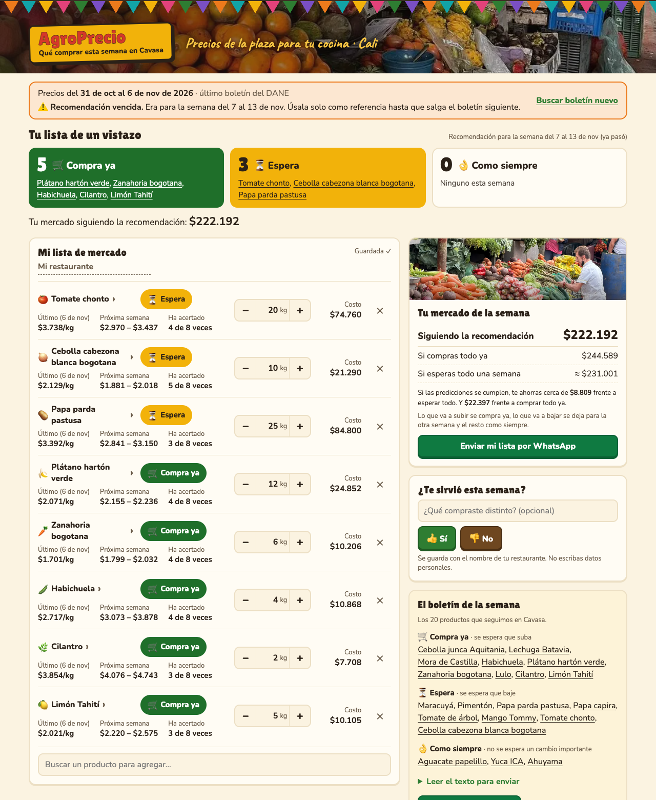
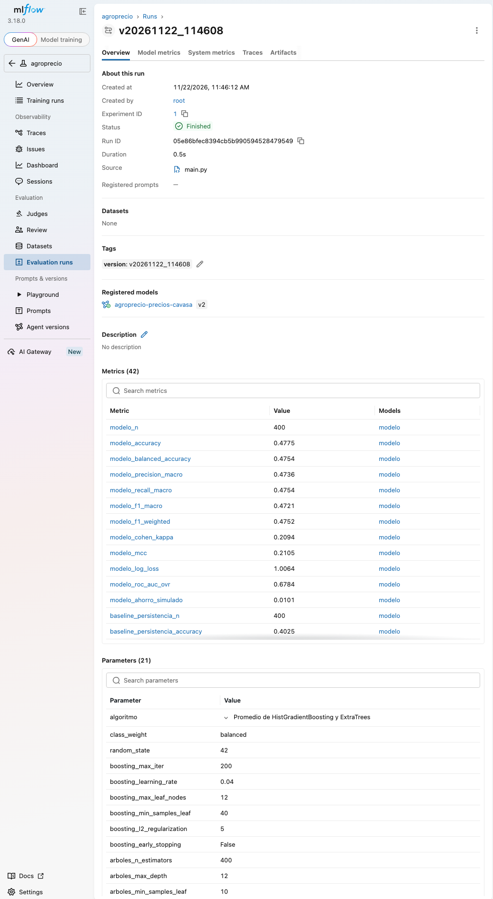
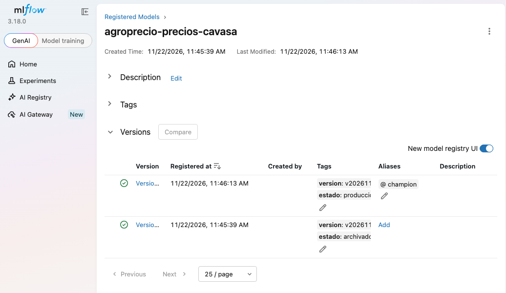
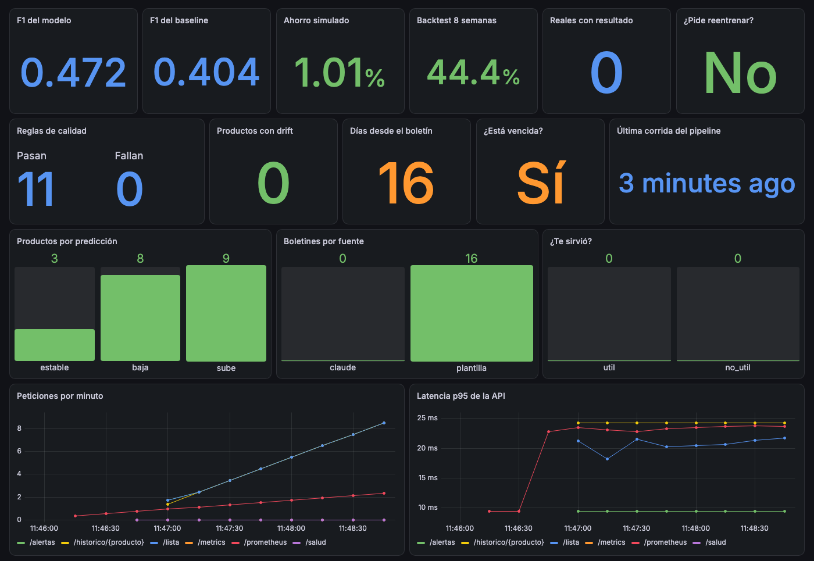
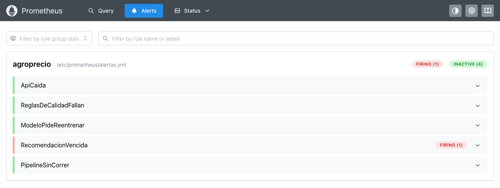
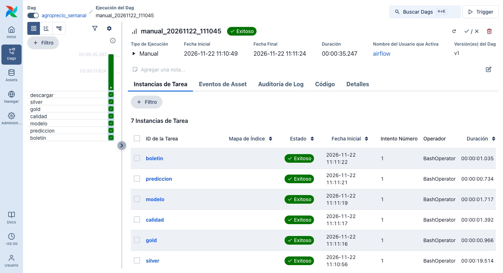

# AgroPrecio

Alertas semanales de compra para restaurantes pequeños de Cali, basadas en los precios mayoristas de Cavasa que publica el DANE (SIPSA).

Cada semana AgroPrecio descarga el boletín del SIPSA, predice si el precio de 20 insumos frescos va a **subir, bajar o seguir estable** la semana siguiente y le dice al dueño del restaurante qué le conviene comprar ya y qué puede esperar. Claude puede redactar el mensaje en lenguaje sencillo; sin clave de API se usa una plantilla.


## Evidencias

### Dashboard

Datos reales de Cavasa. El aviso naranja aparece porque el DANE va atrasado: el último boletín disponible el 22 de noviembre de 2026 era el del 31 de octubre al 6 de noviembre.



### MLflow

La versión en producción con sus métricas, las de los baselines y los parámetros.



En el registro, la versión en producción tiene el alias `champion` y las anteriores quedan archivadas.



### Prometheus y Grafana

El tablero reúne modelo, datos y producto. Muestra lo que está bien y lo que no: la recomendación está vencida y ninguna predicción real tiene resultado. Todavía no hay opiniones ni boletines de Claude, y el tráfico de la captura es de prueba.



La recomendación vencida también dispara una alerta en Prometheus.



### Airflow

Una corrida completa del DAG `agroprecio_semanal`: las siete etapas terminan bien al primer intento, en 35 s.



## El problema

Un restaurante pequeño gasta buena parte de su costo en frutas, verduras y tubérculos, y esos precios cambian mucho de una semana a otra. El DANE publica cada viernes los precios de todas las centrales mayoristas del país, pero en un Excel de más de 4.000 filas que casi nadie consulta. La decisión de compra se toma a ojo.

Más detalle en [docs/01_problema_y_kpis.md](docs/01_problema_y_kpis.md).

## Cómo lo usa el restaurante

El dashboard (http://localhost:8080) está pensado para el dueño del restaurante, no para un analista:

1. **De un vistazo.** Lo primero que ve: cuántos productos de su lista conviene comprar ya, cuáles puede esperar y cuánto cuesta el mercado siguiendo la recomendación.
2. **Mi lista de mercado.** Anota lo que compra cada semana y cuántos kilos. La lista queda guardada en la base (tabla `listas`). Cada producto muestra qué hacer (*Compra ya*, *Espera* o *Como siempre*), el último precio con su fecha, el rango esperado para la próxima semana y cuántas veces acertó el modelo en las últimas 8 semanas. Para agregar un producto lo busca por nombre, y si quita uno por error puede deshacerlo.
3. **Tu mercado de la semana.** Cuánto le cuesta la lista si compra todo ya, si espera todo una semana y si sigue la recomendación. Puede enviar su lista por WhatsApp.
   - **Ahorro real con la lista.** Con las predicciones que AgroPrecio dio cada semana y el precio que el DANE publicó después, muestra cuánto habría pagado el restaurante comprando todo ya y cuánto siguiendo la recomendación, semana por semana y acumulado (`ahorro_real` en `GET /lista`). También cuenta las semanas en que salió más caro.
   - **Mercado de ejemplo.** Un almuerzo corriente para 50 comensales diarios de lunes a sábado (300 platos, unos 220 kg a la semana), calculado a partir de los gramos de cada producto por plato.
4. **Buscar boletín nuevo.** Cuando el DANE publica un boletín, el enlace lo descarga y corre todo el pipeline, mostrando el progreso. Además, la API lo hace sola cada sábado a las 8 a.m. (`update` en `config/config.yaml`).
5. **Todos los precios de Cavasa.** Una tarjeta por cada uno de los 20 productos, con su precio, el cambio de la última semana y la recomendación. Se puede filtrar por recomendación.
6. **Detalle por producto.** Al tocar un producto se abre un panel con los últimos 6 meses en Cavasa frente a la mediana nacional y el rango esperado para la próxima semana.
7. **Boletín de la semana.** Los 20 productos en tres listas cortas, y el texto redactado por Claude o con la plantilla, listo para enviar por WhatsApp o copiar.
8. **¿Te sirvió esta semana?** La respuesta queda guardada y se ve en Grafana.

Si la semana recomendada ya pasó porque el DANE va atrasado, el dashboard lo avisa.

Las fotos de los productos vienen de Wikimedia Commons; los autores y licencias están en [CREDITOS.md](frontend/public/img/productos/CREDITOS.md).

## Cómo correrlo

Todo se maneja con `make`. Escribe `make` para ver la lista de comandos.

```bash
cp .env.example .env    # opcional: ANTHROPIC_API_KEY y puertos
```

| Comando | Qué hace |
|---|---|
| `make docker` | Todo con Docker: pipeline, API, dashboard, MLflow, Prometheus y Grafana |
| `make airflow` / `make airflow-run` | Enciende Airflow (opcional) / dispara el DAG y muestra cada tarea |
| `make monitoring` | Solo MLflow, Prometheus y Grafana |
| `make status` / `make open` | Qué está encendido / abre dashboard, MLflow y Grafana |
| `make tools` | Abre en Chrome MLflow, Grafana, Prometheus y Airflow (los que estén encendidos) |
| `make docker-pipeline` | Solo el pipeline en Docker |
| `make docker-api` / `make docker-web` | Solo la API, o API + dashboard, sin correr el pipeline |
| `make docker-stop` | Apaga los contenedores |
| `make install` | Crea `.venv` e instala Python y Node para correr local |
| `make all` | Local: pipeline y luego API + dashboard juntos |
| `make pipeline` / `make pipeline-fast` | Pipeline completo, o sin descargar |
| `make retrain` / `make docker-retrain` | Fuerza un modelo nuevo, local o en Docker |
| `make experiments` | Compara variantes del modelo |
| `make api` / `make web` | Solo la API (:8000) o solo el dashboard (:5173) |
| `make test` / `make notebook` | Tests y notebook de exploración |
| `make clean` | Borra silver, gold, modelos y logs (bronze se conserva) |

Si un puerto ya está ocupado: `API_PORT=8001 make docker`, o cámbialo en `.env`.

| Servicio | URL |
|---|---|
| Dashboard | http://localhost:8080 |
| API | http://localhost:8000/docs |
| MLflow | http://localhost:5002 |
| Prometheus | http://localhost:9092 |
| Grafana | http://localhost:3002 (se ve sin cuenta; para editar, `admin` / `admin`) |
| Airflow | http://localhost:8082 (sin usuario, solo desde este equipo) |

Docker necesita unos 2 GB de RAM libres, y 2 GB más si se enciende Airflow.

### Con Docker Compose directamente

```bash
docker compose up --build
```

- `pipeline`: descarga los boletines, limpia, entrena si hace falta, predice y genera el boletín. Termina y se apaga.
- `api`: FastAPI en http://localhost:8000 (documentación en `/docs`).
- `web`: dashboard en React en http://localhost:8080.
- `mlflow`, `prometheus` y `grafana`: seguimiento del modelo y monitoreo.

La primera ejecución descarga unos 180 boletines (~50 MB) y tarda unos minutos. Las siguientes solo bajan los boletines nuevos.

### Sin Docker

```bash
python -m venv .venv && source .venv/bin/activate
pip install -r requirements.txt
python main.py                 # pipeline completo
uvicorn api.main:app --reload  # API
cd frontend && npm install && npm run dev   # dashboard en http://localhost:5173
```

Opciones del pipeline:

| Comando | Qué hace |
|---|---|
| `python main.py` | Descarga lo nuevo y corre todo |
| `python main.py --sin-descarga` | Usa solo lo que ya está en `data/bronze` |
| `python main.py --reentrenar` | Fuerza un modelo nuevo |
| `python main.py --etapa silver` | Corre una sola etapa: `descargar`, `silver`, `gold`, `calidad`, `modelo`, `prediccion` o `boletin` |

Tests: `pytest -q`

Para el notebook de exploración: `pip install -r requirements-dev.txt`.

## Arquitectura de datos (medallón)

| Capa | Dónde | Contenido |
|---|---|---|
| Bronze | `data/bronze/*.xlsx` + `manifest.csv` | Boletines tal como los publica el DANE, con su URL y fecha de descarga |
| Silver | `data/silver/precios.parquet` | Una fila por semana, producto y mercado, para todo el país (~786 mil filas) |
| Gold | `data/gold/features.parquet` y `agroprecio.db` | Serie semanal de Cavasa para 20 productos, variables del modelo, predicciones, alertas, monitoreo y boletines |

Cada ejecución corre 12 reglas de calidad sobre silver y gold y las guarda en la tabla `calidad_datos`. Si falla una regla crítica, el pipeline se detiene antes de entrenar o publicar.

## Modelo

- **Qué predice:** la clase del cambio de precio de la próxima semana (`sube` > +3 %, `baja` < -3 %, `estable` en medio).
- **Variables:** 42, más el producto. Historia del precio, posición frente al país, la región y Corabastos, lo que pasó el año anterior, época del año y, desde la v0.7, cómo cerró la semana según los precios diarios del SIPSA (en Cavasa, en Corabastos, en la región y en el país).
- **Algoritmo:** promedio de HistGradientBoosting, ExtraTrees y una red neuronal pequeña (scikit-learn), entrenado con dos mercados de Cali y evaluado en Cavasa. Se eligió entre varias variantes con validación hacia adelante en el tiempo: ver [experimentos](docs/09_experimentos.md).
- **Validación:** corte temporal, con las últimas 20 semanas como prueba. Se compara siempre contra tres baselines.

| | Accuracy | F1 macro | Ahorro simulado |
|---|---|---|---|
| **Ensamble con red neuronal y precios diarios (v0.7)** | **0,54** | **0,53** | **+1,1 %** |
| HistGradientBoosting + ExtraTrees (v0.6) | 0,48 | 0,47 | +1,0 % |
| Random Forest (v0.5) | 0,45 | 0,45 | +0,4 % |
| Baseline: repetir lo de la semana pasada | 0,40 | 0,40 | -0,3 % |
| Baseline: siempre estable | 0,27 | 0,14 | 0 % |
| Baseline: comprar todo hoy | 0,34 | 0,17 | -0,7 % |

El dashboard solo dice *Compra ya* o *Espera* cuando la confianza del modelo es de 50 % o más. Eso pasa en cerca de la mitad de los casos, y ahí acierta 62 %; en el resto dice *Como siempre, sin señal clara*.

La mejora de la v0.7 viene de un dato nuevo, no del algoritmo: el F1 sube entre 0,03 y 0,10 (intervalo de 95 %), y el ahorro simulado queda igual. Ver [experimentos](docs/09_experimentos.md).

`GET /metrics` re-evalúa cada versión guardada sobre su periodo de prueba, junto a los tres baselines, y devuelve accuracy, balanced accuracy, precision, recall, F1 (macro y ponderado), kappa de Cohen, MCC, log loss, ROC AUC y el ahorro simulado. También trae las métricas por clase, la matriz de confusión y el acierto de las predicciones de producción que ya tienen resultado real. Con `/metrics?formato=html` se ve como tabla en el navegador.

Un modelo solo pasa a producción si le gana al baseline. Las versiones quedan en `models/registry.json` con sus datos, parámetros y métricas, y se copian a MLflow.

**Qué tan seguro es:** el ahorro mejora con claridad frente a la v0.5 (la diferencia va de +0,2 a +1,1 puntos, con 95 % de confianza); el F1, no tanto (de -0,03 a +0,08). El modelo se equivoca más de la mitad de las veces.

**Estado real:** el acierto de las últimas 8 semanas es 0,44 y viene del backtest. Las 20 predicciones hechas antes de conocer el resultado todavía esperan el siguiente boletín. Ver [docs/model_card.md](docs/model_card.md).

## Operación (MLOps, LLMOps y DataOps)

- **CI** (`.github/workflows/ci.yml`): 67 tests, construcción de las imágenes Docker y carga del DAG en cada push.
- **MLflow:** experimentos, registro con alias `champion` y trazas del boletín. Es opcional: sin servidor, el pipeline sigue igual.
- **Prometheus y Grafana:** tráfico de la API, modelo, calidad de datos, vigencia y opiniones, con cinco alertas.
- **Airflow:** el DAG `agroprecio_semanal` corre una tarea por etapa, miércoles y sábado.
- **Pipeline semanal** (`.github/workflows/pipeline_semanal.yml`): corre miércoles y sábado, baja el boletín nuevo y publica la base y el registro del modelo como artefactos.
- **Monitoreo:** se cruza cada predicción con lo que realmente pasó, se calcula el acierto de las últimas 8 semanas (y aparte el de las predicciones reales) y se marca drift cuando un cambio de precio es atípico (z > 3). Si el acierto cae por debajo de 0,40 y hay datos nuevos, el siguiente run reentrena.
- **LLM:** cada llamada a Claude queda en `logs/llm.jsonl` con prompt, respuesta, tokens y latencia. Si el texto trae precios que no están en los datos, se descarta y se usa la plantilla. Sin API key, el producto funciona igual con la plantilla.

Detalle en [docs/05_operacion.md](docs/05_operacion.md).

## Estructura

```
├── main.py                  # orquesta el pipeline
├── config/config.yaml       # mercado, productos, umbrales, rutas
├── src/
│   ├── extract/             # descarga y lectura de los Excel del SIPSA
│   ├── transform/           # limpieza (silver) y variables (gold)
│   ├── load/                # SQLite
│   ├── model/               # entrenamiento, predicción, monitoreo y MLflow
│   ├── llm/                 # boletín con Claude
│   ├── quality.py           # reglas de calidad de datos
│   ├── vigencia.py          # si la recomendación sigue vigente
│   └── opiniones.py         # respuestas a "¿te sirvió?"
├── dags/                    # DAG de Airflow
├── docker/                  # MLflow, Prometheus, Grafana y Airflow
├── api/                     # FastAPI y métricas de Prometheus
├── frontend/                # React + Vite
├── tests/
├── notebooks/               # exploración
├── docs/                    # problema, lienzos, metodología, operación
├── data/{bronze,silver,gold}
├── models/  logs/
├── Dockerfile  docker-compose.yml
```

## Documentación

1. [Problema, usuarios y KPIs](docs/01_problema_y_kpis.md)
2. [Business Model Canvas](docs/02_canvas.md)
3. [Data Innovation Board](docs/03_data_innovation_board.md)
4. [Metodología: CRISP-DM y Scrum ML](docs/04_metodologia.md)
5. [Operación: DataOps, MLOps y LLMOps](docs/05_operacion.md)
6. [AI Canvas](docs/06_ai_canvas.md)
7. [Validación con restaurantes](docs/07_validacion.md)
8. [Guion del pitch](docs/08_pitch.md)
9. [Experimentos del modelo](docs/09_experimentos.md)
10. [Despliegue en Azure](docs/10_despliegue_azure.md)
11. [Model card](docs/model_card.md)
12. [Diccionario de datos](docs/diccionario_datos.md)
13. [Historial de versiones](CHANGELOG.md)

## Fuente de datos

DANE, Sistema de Información de Precios y Abastecimiento del Sector Agropecuario (SIPSA), boletín semanal de precios mayoristas. Son datos públicos y no tienen información personal.
